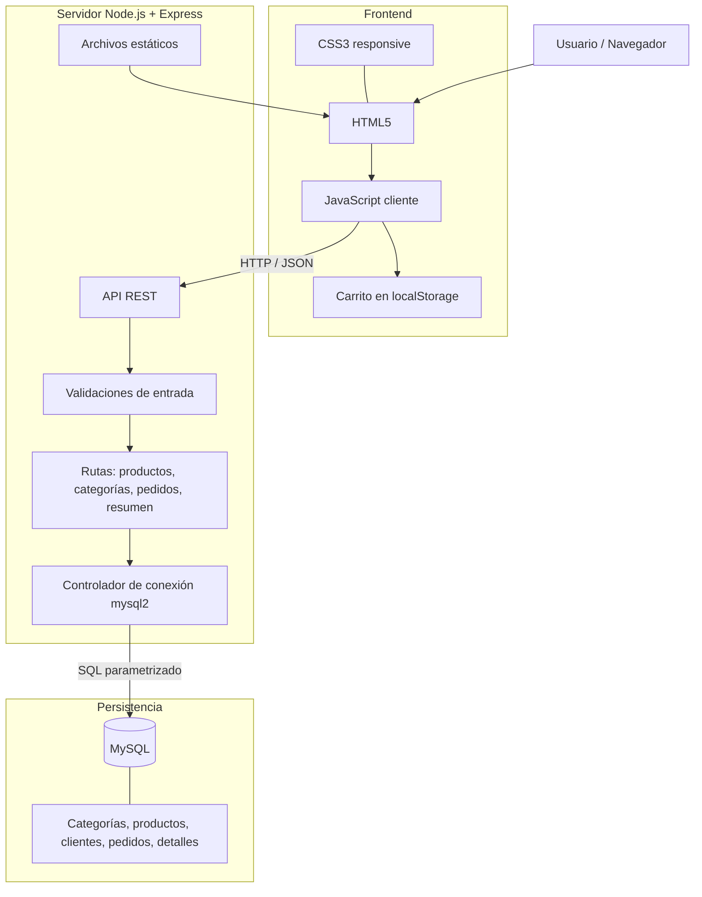

# Arquitectura de software

## Estilo

La solución utiliza una arquitectura web de tres capas lógicas (frontend, backend/API y base de datos). El navegador no se conecta directamente a MySQL: envía solicitudes HTTP al servidor Express, que valida los datos y consulta la base de datos mediante el controlador mysql2.

## Diagrama de componentes

## Comunicación

1. El navegador descarga el HTML, CSS y JavaScript servidos por Express.
2. El cliente solicita productos y categorías con `fetch`, recibiendo JSON.
3. El backend valida parámetros, utiliza consultas parametrizadas y devuelve respuestas HTTP.
4. Para crear pedidos, el servidor vuelve a consultar precios y existencias, y registra cabecera y detalles en una transacción.
5. MySQL persiste los registros. Las credenciales se leen desde variables de entorno y no deben subirse al repositorio.

## Decisiones técnicas

- HTML, CSS y JavaScript sin framework de interfaz para hacer visible el uso de las tecnologías de la asignatura.
- Express simplifica las rutas del servidor.
- MySQL permite modelar relaciones entre categorías, productos, clientes, pedidos y detalles.
- Las consultas parametrizadas reducen el riesgo de inyección SQL.
- Las transacciones permiten guardar el pedido y sus ítems de forma consistente.
- El carrito permanece en localStorage del navegador; la información definitiva del pedido se calcula y valida en el servidor.
- Helmet agrega cabeceras HTTP de seguridad. La configuración actual desactiva CSP para permitir el prototipo; esta política debe definirse adecuadamente antes de producción.

## Limitaciones

No se incluye autenticación de administrador ni pago real. El endpoint de resumen es público y de solo lectura para la demostración, por lo que no debe publicarse con datos comerciales. Imágenes externas y Google Fonts requieren conexión a internet.