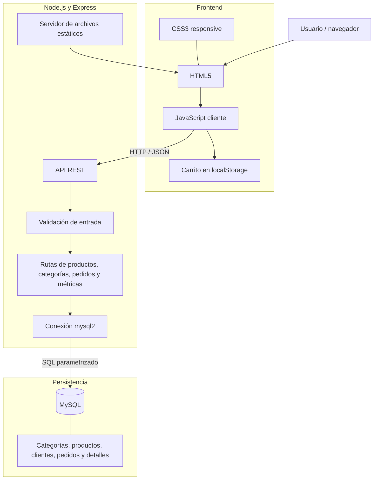

# Arquitectura de software

## Estilo arquitectónico

Nexora Gaming & Tech utiliza una arquitectura web de tres capas lógicas: presentación, aplicación y persistencia. El navegador no accede directamente a MySQL; consume una API REST implementada con Express, que procesa las solicitudes y ejecuta las consultas necesarias.

## Diagrama de componentes

## Comunicación entre capas

1. Express entrega los archivos de la interfaz.
2. JavaScript solicita categorías y productos mediante Fetch API.
3. La API valida los parámetros y responde en formato JSON.
4. El servidor vuelve a consultar precios y existencias cuando se registra un pedido.
5. MySQL almacena los datos y garantiza la consistencia de la operación mediante transacciones.

## Decisiones de diseño

- HTML5, CSS3 y JavaScript permiten mostrar directamente la estructura y la lógica del frontend.
- Express organiza los endpoints y centraliza el manejo de solicitudes.
- mysql2 proporciona la conexión entre Node.js y MySQL y admite consultas parametrizadas.
- Las transacciones agrupan la cabecera del pedido, los detalles y la actualización de existencias.
- El carrito se mantiene en localStorage; el precio definitivo se consulta en el backend.
- dotenv mantiene la configuración local fuera del código versionado.
- Helmet define cabeceras HTTP y una política de seguridad de contenido compatible con los recursos utilizados.
- CORS no habilita orígenes externos por defecto; los orígenes adicionales se configuran mediante la variable `CORS_ORIGINS`.

## Limitaciones

El panel de métricas es de lectura y no tiene autenticación ni control de roles. El prototipo no incorpora pasarela de pago, facturación electrónica, logística ni entrega de códigos digitales reales. Las imágenes y fuentes externas requieren conexión a internet.
