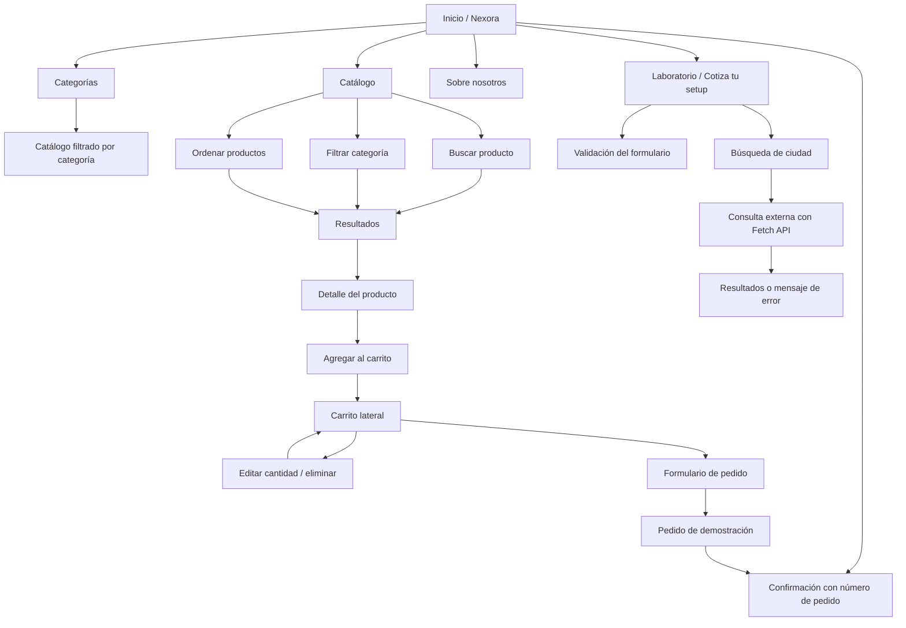

# Mapa de navegación

## Flujo principal

## Descripción

- **Inicio:** presentación, accesos a categorías, productos destacados y descripción del proyecto.
- **Catálogo:** búsqueda por nombre/descripción, filtro por categoría y opciones de ordenamiento.
- **Detalle del producto:** muestra categoría, descripción, precio y disponibilidad de demostración; permite agregar el artículo al carrito.
- **Categorías:** accesos rápidos que preseleccionan un filtro.
- **Carrito:** muestra referencias, cantidades y subtotal; permite modificar o retirar productos.
- **Formulario de pedido:** recoge nombre y correo, valida los campos y envía una solicitud a la API.
- **Confirmación:** comunica el número del pedido de prueba e indica que no se procesó ningún pago.
- **Sobre nosotros:** explica la finalidad del prototipo.
- **Laboratorio / Cotiza tu setup:** contiene un formulario con validación en tiempo real para nombre, correo y presupuesto; la confirmación es local y no envía datos personales.
- **Búsqueda de ciudad:** consulta Open-Meteo Geocoding API mediante Fetch y async/await, y presenta resultados, ausencia de coincidencias o mensajes ante errores.
- **Panel de demostración:** ruta independiente admin.html que muestra métricas de catálogo, pedidos y unidades mediante la API; es de lectura y no tiene autenticación.

## Rutas de API

| Método | Ruta | Propósito |
|---|---|---|
| GET | `/api/health` | Verificar que el servidor está activo |
| GET | `/api/categories` | Consultar categorías |
| GET | `/api/products` | Listar, buscar y filtrar productos |
| GET | `/api/products/:id` | Consultar el detalle de un producto |
| POST | `/api/orders` | Crear un pedido de demostración |
| GET | `/api/admin/summary` | Consultar métricas de solo lectura |

El flujo dibujado representa la navegación funcional de la aplicación, incluido el laboratorio de DOM y asincronía. La sección geográfica es informativa y no confirma cobertura de envíos. La administración completa, autenticación y pago real no forman parte del alcance inicial.