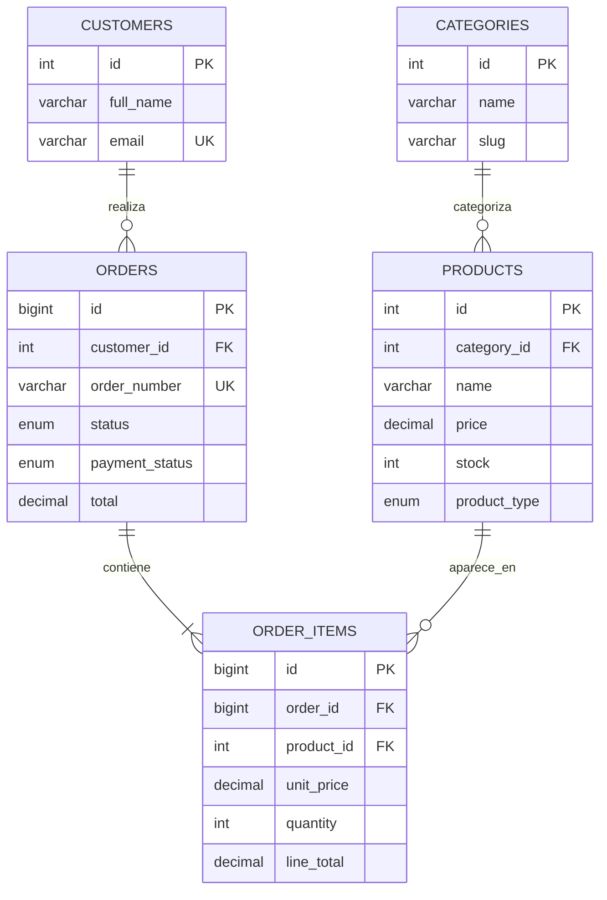

# Modelo entidad–relación — Nexora Gaming & Tech

El siguiente diagrama documenta las relaciones del esquema MySQL inicial.

## Justificación de las relaciones

- Una categoría puede agrupar muchos productos, pero un producto inicial pertenece a una categoría.
- Un cliente puede realizar varios pedidos.
- Cada pedido incluye uno o más detalles; cada detalle referencia un producto.
- Los detalles guardan el nombre y precio como fotografía histórica del producto para que los valores del pedido no dependan de cambios futuros en el catálogo.

## Limitación

Es el modelo relacional del prototipo académico. No incluye pasarela de pagos, facturación fiscal, proveedores, envíos ni usuarios con roles de administrador.
